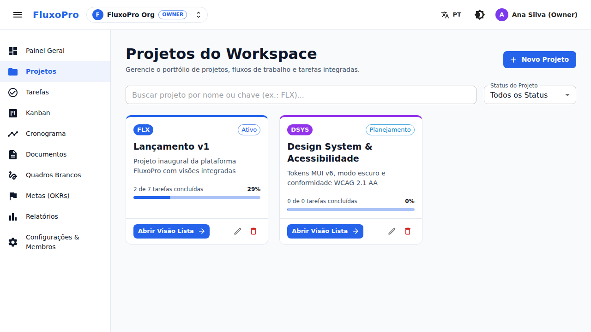
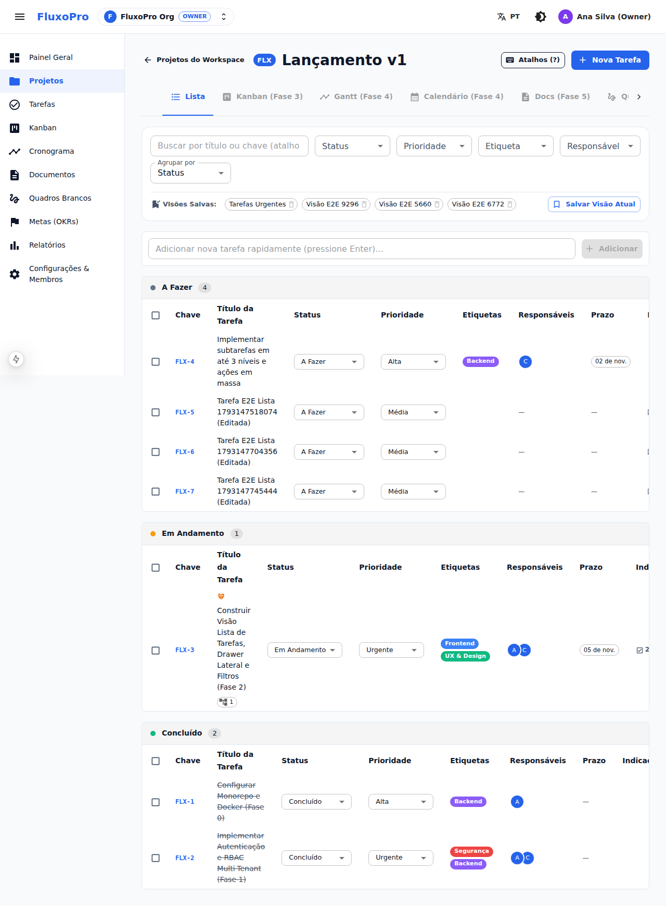
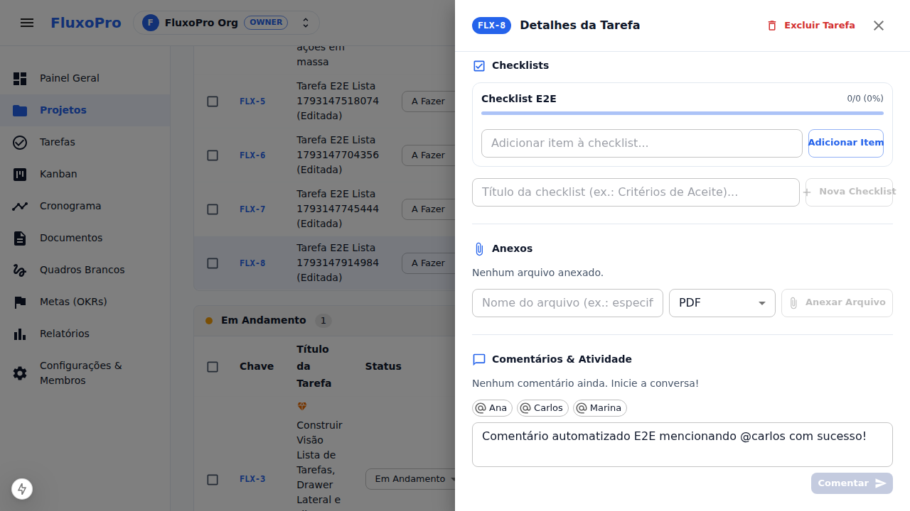
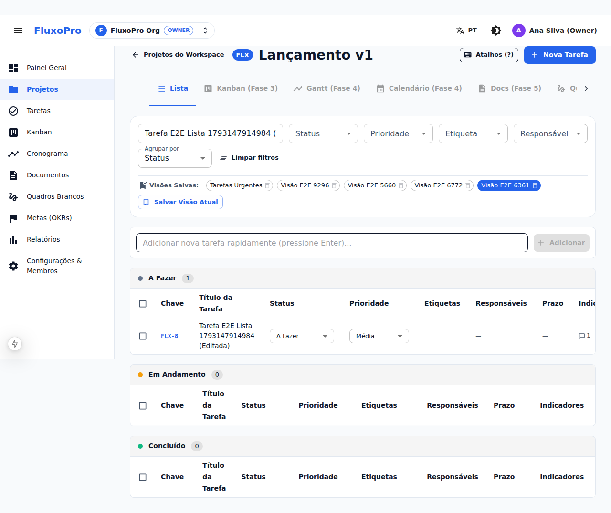

# Walkthrough — Fase 2: Projetos e Tarefas (Visão Lista)

> [!NOTE]
> Este documento detalha tudo o que foi implementado, testado e validado visualmente na **Fase 2** da plataforma **FluxoPro**, conforme especificado em [SPEC.md](file:///home/talita/projetos/cacique-agil/SPEC.md) e [AGENTS.md](file:///home/talita/projetos/cacique-agil/AGENTS.md).

---

## 1. Resumo das Entregas da Fase 2

### Pacote Compartilhado (`@fluxo/shared`)
- **[project.ts](file:///home/talita/projetos/cacique-agil/packages/shared/src/schemas/project.ts)**: Schemas Zod e tipos inferidos para `WorkflowStatusSchema`, `CreateWorkflowStatusRequestSchema`, `ProjectSchema`, `CreateProjectRequestSchema`, `UpdateProjectRequestSchema`, `SavedViewConfigSchema`, `SavedViewSchema` e `CreateSavedViewRequestSchema`.
- **[task.ts](file:///home/talita/projetos/cacique-agil/packages/shared/src/schemas/task.ts)**: Schemas Zod e tipos inferidos para `LabelSchema`, `CreateLabelRequestSchema`, `AttachLabelRequestSchema`, `ChecklistItemSchema`, `ChecklistSchema`, `CreateChecklistRequestSchema`, `CreateChecklistItemRequestSchema`, `UpdateChecklistItemRequestSchema`, `CommentBodySchema`, `CommentSchema`, `CreateCommentRequestSchema`, `AttachmentSchema`, `CreateAttachmentRequestSchema`, `TaskSchema`, `CreateTaskRequestSchema`, `UpdateTaskRequestSchema`, `MoveTaskRequestSchema`, `BulkTasksActionSchema` e `TaskFilterQuerySchema`.
- **[index.ts](file:///home/talita/projetos/cacique-agil/packages/shared/src/index.ts)**: Reexportação centralizada de todos os schemas e DTOs.

### Backend (`@fluxo/api`)
Arquitetura estritamente em camadas (`routes → controller → service → repository`) com autorização multi-tenant por workspace (`requireAuth`, `requireWorkspaceMember`, `requireWorkspaceRole`) e auditoria em `AuditLog`:
- **Módulo de Projetos**:
  - [projects.repository.ts](file:///home/talita/projetos/cacique-agil/apps/api/src/modules/projects/projects.repository.ts)
  - [projects.service.ts](file:///home/talita/projetos/cacique-agil/apps/api/src/modules/projects/projects.service.ts): Criação transacional do projeto com os 4 status padrão (`A Fazer / TODO`, `Em Andamento / IN_PROGRESS`, `Em Revisão / REVIEW`, `Concluído / DONE`), cálculo de progresso (`taskCount`, `completedTaskCount`), gestão de etiquetas (`Label`) do workspace e visões salvas (`SavedView`).
  - [projects.controller.ts](file:///home/talita/projetos/cacique-agil/apps/api/src/modules/projects/projects.controller.ts) & [projects.routes.ts](file:///home/talita/projetos/cacique-agil/apps/api/src/modules/projects/projects.routes.ts)
- **Módulo de Tarefas**:
  - [tasks.repository.ts](file:///home/talita/projetos/cacique-agil/apps/api/src/modules/tasks/tasks.repository.ts)
  - [tasks.service.ts](file:///home/talita/projetos/cacique-agil/apps/api/src/modules/tasks/tasks.service.ts):
    - Geração sequencial de `number` e `key` (`FLX-1`, `FLX-2`...) por projeto.
    - Cálculo de ordenação lexicográfica (`position`) e atualização automática de `completedAt` ao entrar/sair de status `DONE`.
    - Validação de **subtarefas até 3 níveis de profundidade** (rejeitando nível > 3 com erro `422 Unprocessable Entity`).
    - Ações em massa (`POST /api/v1/tasks/bulk`) para alterar status, prioridade ou realizar *soft delete* (`deletedAt`).
    - CRUD de Checklists e itens de checklist.
    - Comentários com parser de `@menções` e geração automática de notificações (`TASK_MENTIONED`, `TASK_ASSIGNED`).
    - Validação de anexos com whitelist de MIME types (`PDF`, `PNG`, `JPEG`, `WEBP`, `TXT`, `CSV`, `JSON`, `ZIP`) e limite de 10 MB.
  - [tasks.controller.ts](file:///home/talita/projetos/cacique-agil/apps/api/src/modules/tasks/tasks.controller.ts) & [tasks.routes.ts](file:///home/talita/projetos/cacique-agil/apps/api/src/modules/tasks/tasks.routes.ts)
- **Documentação OpenAPI**:
  - [openapi.ts](file:///home/talita/projetos/cacique-agil/apps/api/src/openapi/openapi.ts) atualizado com todos os endpoints da Fase 2 (`/api/docs`).

### Banco de Dados & Seed (`prisma/seed.ts`)
- **[seed.ts](file:///home/talita/projetos/cacique-agil/prisma/seed.ts)**: Popula etiquetas (`Backend`, `Frontend`, `Segurança`, `UX & Design`), 2 projetos (`FLX — Lançamento v1` e `DSYS — Design System & Acessibilidade`), 4 tarefas (`FLX-1` a `FLX-4`) incluindo subtarefa hierárquica, checklist com itens, comentário com `@carlos`, anexo validado e visão salva compartilhada (`Tarefas Urgentes`).

### Frontend (`@fluxo/web`)
- **Internacionalização (`pt-BR` e `en`)**: Dicionários completos em [pt-BR.json](file:///home/talita/projetos/cacique-agil/apps/web/src/i18n/messages/pt-BR.json) e [en.json](file:///home/talita/projetos/cacique-agil/apps/web/src/i18n/messages/en.json).
- **Cliente HTTP Tipado**: `projectsApi` e `tasksApi` adicionados em [api-client.ts](file:///home/talita/projetos/cacique-agil/apps/web/src/lib/api-client.ts).
- **Páginas e Componentes MUI v6**:
  - [projects/page.tsx](file:///home/talita/projetos/cacique-agil/apps/web/src/app/%5Blocale%5D/projects/page.tsx) e [CreateProjectDialog.tsx](file:///home/talita/projetos/cacique-agil/apps/web/src/components/projects/CreateProjectDialog.tsx): Portfólio de projetos com busca, filtro por status, barra de progresso e modal de criação/edição.
  - [projects/[projectId]/page.tsx](file:///home/talita/projetos/cacique-agil/apps/web/src/app/%5Blocale%5D/projects/%5BprojectId%5D/page.tsx): Visão Lista integrada com abas de visão, barra de filtros, visões salvas e atalhos globais de teclado (`C`, `/`, `Esc`, `?`).
  - [TaskFiltersBar.tsx](file:///home/talita/projetos/cacique-agil/apps/web/src/components/tasks/TaskFiltersBar.tsx): Busca textual, filtros combináveis (Status, Prioridade, Etiqueta, Responsável), seletor de agrupamento e chips de Visões Salvas.
  - [TaskListView.tsx](file:///home/talita/projetos/cacique-agil/apps/web/src/components/tasks/TaskListView.tsx): Agrupamento por Status ou Prioridade, criação rápida inline (`Enter`), edição inline de status/prioridade, seleção múltipla e barra de ações em massa.
  - [TaskDetailDrawer.tsx](file:///home/talita/projetos/cacique-agil/apps/web/src/components/tasks/TaskDetailDrawer.tsx): Drawer lateral completo com edição de título/descrição, metadados, etiquetas, árvore de subtarefas até 3 níveis, checklists com progresso, anexos validados e comentários com `@menções`.
  - [CreateTaskDialog.tsx](file:///home/talita/projetos/cacique-agil/apps/web/src/components/tasks/CreateTaskDialog.tsx) e [KeyboardShortcutsDialog.tsx](file:///home/talita/projetos/cacique-agil/apps/web/src/components/tasks/KeyboardShortcutsDialog.tsx).

---

## 2. Validação Visual no Navegador (Screenshots)

---

## 3. Resultados de Verificação (`Definition of Done`)

| Etapa | Comando | Resultado |
| :--- | :--- | :--- |
| **Lint** | `pnpm lint` | **Passou** (0 erros, 0 avisos em `@fluxo/shared`, `@fluxo/api`, `@fluxo/web`) |
| **Typecheck** | `pnpm typecheck` | **Passou** (`tsc --noEmit` estrito sem erros em todo o monorepo) |
| **Testes Unitários & Integração** | `pnpm test` | **Passou** (4 suítes / 16 testes em `@fluxo/api`, incluindo [projects-tasks.test.ts](file:///home/talita/projetos/cacique-agil/apps/api/tests/projects-tasks.test.ts); 3 suítes / 4 testes em `@fluxo/web`, incluindo [TaskListView.test.tsx](file:///home/talita/projetos/cacique-agil/apps/web/tests/TaskListView.test.tsx)) |
| **Testes E2E (Playwright)** | `pnpm test:e2e` | **Passou** (2 suítes completas: Fase 1 + Fase 2 `criar → editar → comentar → filtrar` em [phase2-projects-tasks.spec.ts](file:///home/talita/projetos/cacique-agil/apps/web/e2e/phase2-projects-tasks.spec.ts)) |
| **Docker & Seed** | `pnpm docker:up && pnpm db:seed` | **Passou** (PostgreSQL 16, Mailpit, API na porta `4000`, Web na porta `3000`) |

---

## 4. O que ficou pendente para as próximas fases (Roadmap)

Conforme o cronograma incremental definido na Seção 11 de [SPEC.md](file:///home/talita/projetos/cacique-agil/SPEC.md):
- **Fase 3 — Quadro Kanban:** Drag-and-drop com `@dnd-kit`, reordenação persistente entre colunas, limite WIP por coluna com destaque visual de excesso e swimlanes opcionais por prioridade/responsável.
- **Fase 4 — Cronograma (Gantt) e Calendário:** Barras proporcionais às datas (`startDate`/`dueDate`), dependências (`BLOCKS` / `BLOCKED_BY`) com detecção de ciclo em grafo dirigido, marcos (`isMilestone`) e visão mensal/semanal de Calendário.
- **Fase 5 — Documentos Colaborativos:** Árvore de páginas por workspace/projeto com editor rico Tiptap, histórico de versões e vínculo entre trechos e tarefas.
- **Fase 6 — Quadros Brancos (Canvas):** Canvas interativo com pan/zoom, formas, post-its, conectores e conversão direta de post-it em tarefa.
- **Fase 7 — Metas (OKRs), Relatórios e Tempo:** Objetivos e Key Results vinculados a tarefas, gráficos com `@mui/x-charts`, registro de tempo (`TimeEntry`) com cronômetro e exportação CSV.
- **Fase 8 — Polimento, Notificações, Busca Global (`Ctrl+K`), Acessibilidade e CI:** Central de notificações no topo, Command Palette (`Ctrl+K`), webhooks de saída com assinatura HMAC e pipeline GitHub Actions.
