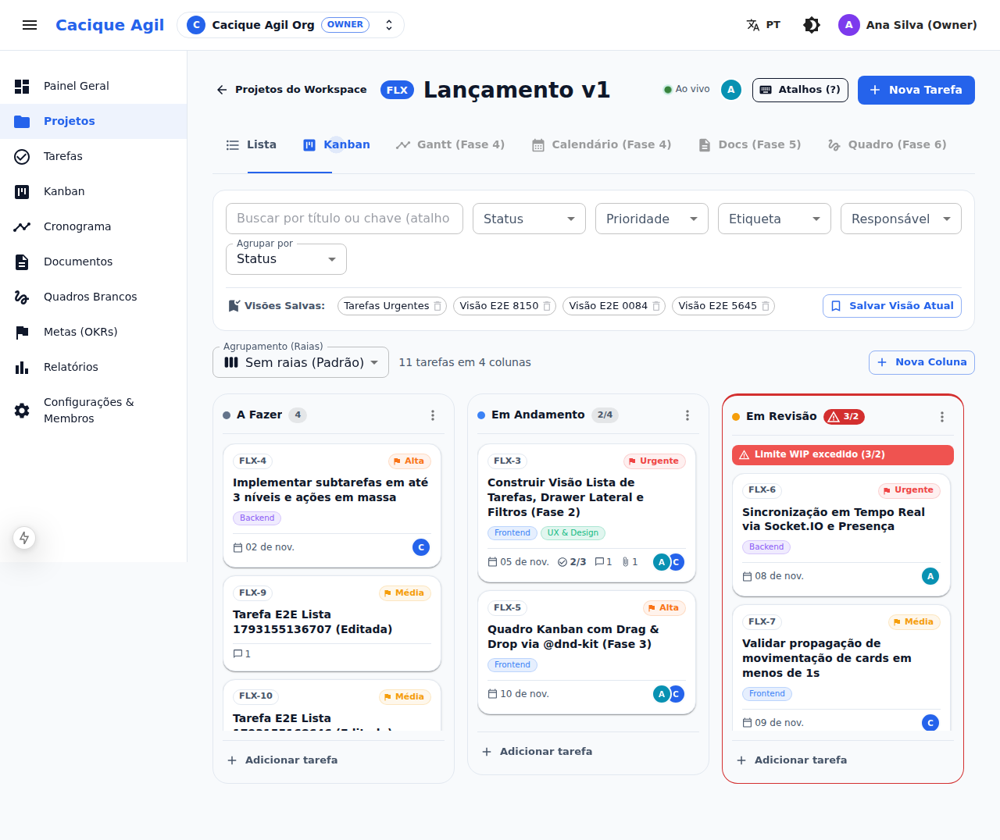
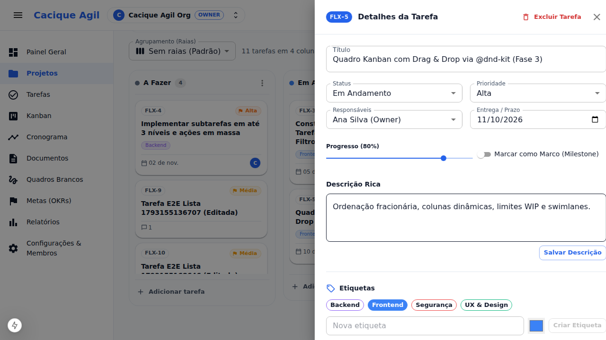
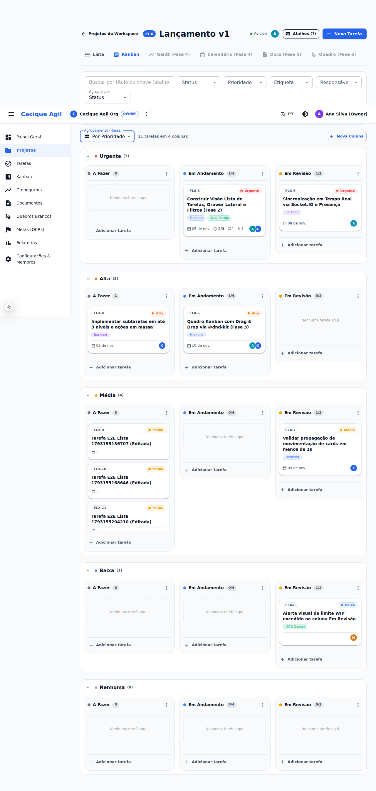
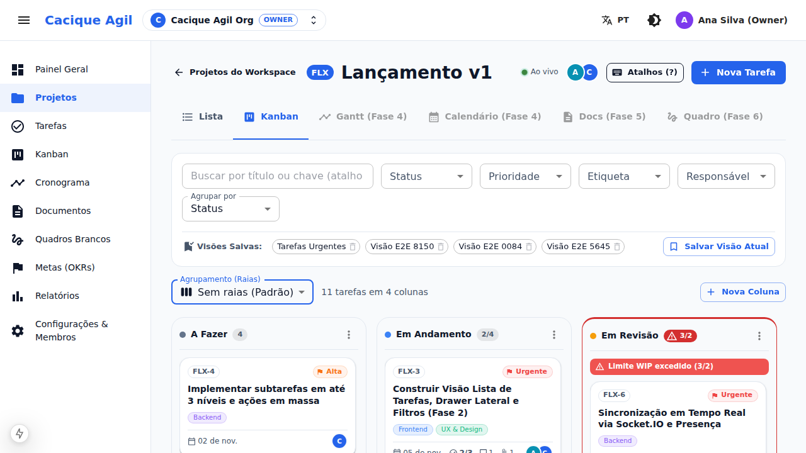

# Walkthrough — Fase 3: Quadro Kanban e Tempo Real

> [!NOTE]
> Este documento detalha tudo o que foi implementado, testado e validado visualmente na **Fase 3** da plataforma **Cacique Agil**, conforme especificado em [SPEC.md](file:///home/talita/projetos/cacique-agil/SPEC.md) e [AGENTS.md](file:///home/talita/projetos/cacique-agil/AGENTS.md).

---

## 1. Resumo das Entregas da Fase 3

### Pacote Compartilhado (`@fluxo/shared`)
- **[project.ts](file:///home/talita/projetos/cacique-agil/packages/shared/src/schemas/project.ts)**:
  - Adicionado `UpdateWorkflowStatusRequestSchema` para edição de nome, cor, categoria e limite WIP (`wipLimit: z.number().int().positive().nullable().optional()`).
  - Adicionado `ReorderWorkflowStatusesRequestSchema` para reordenação de colunas do quadro.
- **[realtime.ts](file:///home/talita/projetos/cacique-agil/packages/shared/src/schemas/realtime.ts)**:
  - Tipos e schemas Zod compartilhados para todos os eventos WebSocket: `task.created`, `task.updated`, `task.moved`, `task.deleted`, `status.created`, `status.updated`, `status.deleted`, `comment.created`, `presence.update`.
- **[index.ts](file:///home/talita/projetos/cacique-agil/packages/shared/src/index.ts)**: Reexportação centralizada dos novos schemas e tipos.

### Backend (`@fluxo/api`)
- **Servidor WebSocket & Tempo Real (`src/realtime/`)**:
  - [socket.server.ts](file:///home/talita/projetos/cacique-agil/apps/api/src/realtime/socket.server.ts): Inicialização do `Server` do Socket.IO acoplado ao servidor HTTP nativo (`server.ts`) com CORS habilitado.
  - [socket.auth.ts](file:///home/talita/projetos/cacique-agil/apps/api/src/realtime/socket.auth.ts): Middleware de autenticação handshake via JWT (extraído de `socket.handshake.auth.token` ou cookie `accessToken`).
  - [socket.rooms.ts](file:///home/talita/projetos/cacique-agil/apps/api/src/realtime/socket.rooms.ts): Autorização de entrada na sala `project:{projectId}` verificando associação ao workspace e controle de presença online em memória (`presence.update`).
  - [socket.emitter.ts](file:///home/talita/projetos/cacique-agil/apps/api/src/realtime/socket.emitter.ts): Emissor fortemente tipado com métodos dedicados (`emitTaskCreated`, `emitTaskUpdated`, `emitTaskMoved`, `emitTaskDeleted`, `emitStatusCreated`, `emitStatusUpdated`, `emitStatusDeleted`, `emitCommentCreated`).
- **Módulo de Projetos & Status**:
  - `PATCH /api/v1/projects/:id/statuses/:statusId`: Atualização de colunas e limites WIP.
  - `DELETE /api/v1/projects/:id/statuses/:statusId`: Exclusão de status com bloqueio de segurança caso existam tarefas associadas.
  - `POST /api/v1/projects/:id/statuses/reorder`: Reordenação em lote da ordem de colunas do Kanban.
- **Módulo de Tarefas & Emissão de Eventos**:
  - `tasks.service.ts` atualizado para despachar eventos em tempo real via `socketEmitter` em todas as mutações (`createTask`, `updateTask`, `moveTask`, `deleteTask`, `addComment`).
- **OpenAPI**:
  - Novos endpoints de status documentados no registro OpenAPI em [openapi.ts](file:///home/talita/projetos/cacique-agil/apps/api/src/openapi/openapi.ts).

### Frontend (`@fluxo/web`)
- **Quadro Kanban Interativo com `@dnd-kit`**:
  - [TaskKanbanView.tsx](file:///home/talita/projetos/cacique-agil/apps/web/src/components/kanban/TaskKanbanView.tsx):
    - Sensores configurados para arrasto (`PointerSensor` com distância mínima de ativação e `KeyboardSensor`).
    - Drag overlay animado com sombra e elevação durante o arrasto.
    - Suporte a arrasto entre colunas e reordenação interna com cálculo de posicionamento fracionário (`position: Float`).
    - Swimlanes configuráveis: `Nenhum`, `Por Prioridade` (`URGENT`, `HIGH`, `MEDIUM`, `LOW`) e `Por Responsável`.
  - [KanbanColumn.tsx](file:///home/talita/projetos/cacique-agil/apps/web/src/components/kanban/KanbanColumn.tsx):
    - Coluna droppable mapeada para `WorkflowStatus`.
    - Indicador de contagem e limite WIP (ex.: `3/2`).
    - Alerta visual com destaque quando o limite WIP é ultrapassado (`warning.main` / `error.main`).
    - Criação rápida de tarefa inline diretamente no rodapé da coluna.
    - Menu de opções da coluna (configurações, limite WIP e exclusão).
  - [KanbanCard.tsx](file:///home/talita/projetos/cacique-agil/apps/web/src/components/kanban/KanbanCard.tsx):
    - Cartão arrastável exibindo chave (`FLX-1`), prioridade com chip colorido, etiquetas, indicador de progresso de checklist (`1/2`), ícones com contagem de comentários e anexos, data de vencimento com destaque para atrasos e avatares dos membros atribuídos.
    - Clique no cartão abre o drawer lateral de detalhes sem interferir no drag-and-drop.
  - [ColumnSettingsDialog.tsx](file:///home/talita/projetos/cacique-agil/apps/web/src/components/kanban/ColumnSettingsDialog.tsx):
    - Diálogo para criar e editar colunas, definir cor de destaque, categoria (`TODO`, `IN_PROGRESS`, `REVIEW`, `DONE`) e limite WIP.
- **Sincronização em Tempo Real e Presença**:
  - [socket.ts](file:///home/talita/projetos/cacique-agil/apps/web/src/lib/socket.ts): Singleton do cliente Socket.IO autenticado com token do auth store.
  - [use-project-realtime.ts](file:///home/talita/projetos/cacique-agil/apps/web/src/features/realtime/use-project-realtime.ts): Hook React para gerenciamento da assinatura do projeto, escuta de eventos, invalidação automática de queries TanStack e rastreamento de usuários online.
  - [PresenceBar.tsx](file:///home/talita/projetos/cacique-agil/apps/web/src/features/realtime/PresenceBar.tsx): Barra de presença no topo da página do projeto com indicador pulsante de status de conexão e stack de avatares com tooltips.
- **Integração na Página do Projeto**:
  - [projects/[projectId]/page.tsx](file:///home/talita/projetos/cacique-agil/apps/web/src/app/%5Blocale%5D/projects/%5BprojectId%5D/page.tsx):
    - Aba "Kanban" habilitada e funcional, sincronizada com a query param `?view=kanban`.
    - `PresenceBar` exibido no topo do projeto.
    - Alternância suave entre a Visão Lista (Fase 2) e a Visão Kanban (Fase 3).

---

## 2. Validação Visual no Navegador (Screenshots)

### 1. Quadro Kanban Completo com Alerta de Limite WIP
Exibe as colunas de fluxo, cartões ricos com etiquetas, progresso de checklist e contadores, e o banner de aviso na coluna **Em Revisão** com o limite WIP excedido (3/2).

---

### 2. Abertura do Drawer de Detalhes a partir do Cartão do Kanban
Demonstra a abertura fluida do drawer lateral de detalhes ao clicar no cartão `FLX-3`, permitindo edição completa de metadados, subtarefas e comentários.

---

### 3. Swimlanes por Prioridade
Demonstra as raias horizontais dobráveis agrupando as tarefas por nível de prioridade (`Urgente`, `Alta`, `Média`, `Baixa`), mantendo as colunas de fluxo em cada raia.

---

### 4. Presença em Tempo Real e Conexão Socket.IO
Demonstra a barra de status de presença no cabeçalho do projeto com indicador verde de conexão ativa e stack de avatares dos membros online na sala.

---

## 3. Resultados dos Testes Automatizados

- **Lint (`pnpm -r lint`)**: 0 erros, 0 avisos.
- **Typecheck (`pnpm typecheck`)**: 100% dos pacotes validados com TypeScript estrito sem erros.
- **Testes Unitários e de Integração (`pnpm test`)**: 10 arquivos de teste, 26 testes passando com sucesso.
  - API (6 arquivos): `auth`, `workspaces`, `projects-tasks`, `email`, `kanban-status`, `socket-realtime`.
  - Web (4 arquivos): `LoginForm`, `WorkspaceSwitcher`, `TaskListView`, `TaskKanbanView`.
- **Testes Ponta a Ponta (`pnpm test:e2e`)**: 3 suites Playwright completas aprovadas:
  - `phase1-auth-workspaces.spec.ts`
  - `phase2-projects-tasks.spec.ts`
  - `phase3-kanban-realtime.spec.ts` (testes multi-contexto de presença em tempo real, Kanban, WIP e swimlanes).
