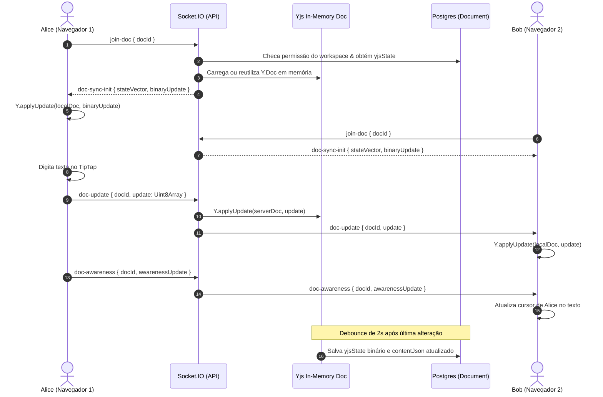

# Implementation Plan — Fase 5: Documentos Colaborativos (Wiki & Rich Text Docs)

**Projeto:** Cacique Agil  
**Fase:** 05 — Documentos Colaborativos  
**Responsável:** Agente da Fase 5  
**Status:** Aguardando Aprovação  

---

## 1. Visão Geral e Objetivos da Fase 5

A Fase 5 do **Cacique Agil** implementa o módulo completo de **Documentos Colaborativos** (Wiki interna de alta performance), conforme especificado nas seções **3**, **4**, **6.6**, **8.2** e **13** da `SPEC.md`.

O diferencial da plataforma é a **interconexão entre módulos**: documentos não são silos isolados, mas espaços vivos de documentação onde tarefas podem ser citadas (`#FLX-12`), embutidas como blocos interativos (com alteração de status inline), modelos estruturados podem ser reutilizados pela equipe e múltiplos usuários podem editar o mesmo texto simultaneamente com convergência garantida por CRDT (**Yjs**).

### Principais Entregáveis:

1. **Editor Rico em Blocos (TipTap / ProseMirror)**:
   - Formatação completa de texto: Títulos (H1, H2, H3), parágrafos, negrito, itálico, tachado, sublinhado, código inline e blocos de código com destaque visual.
   - Listas não ordenadas, listas numeradas e listas de tarefas (checklists interativas).
   - Tabelas completas (inserir tabela, adicionar/remover linhas e colunas, cabeçalhos estilizados).
   - Citações em bloco (*blockquotes*), divisores horizontais e caixas de destaque (*callouts* com variantes de informação, sucesso, aviso e perigo).
   - Menu flutuante contextual (*Bubble Menu*) ao selecionar trechos de texto.
   - Menu de inserção rápida por barra oblíqua (**Slash Commands `/`**) para adicionar qualquer bloco sem tirar as mãos do teclado.

2. **Menções e Vínculos de Entidades**:
   - Menções a membros da equipe (`@nome`), gerando links e destaque visual.
   - Menções a tarefas do workspace (`#FLX-12` ou `@tarefa`), com popover exibindo status, prioridade e link direto.
   - Vínculos com metas e links inteligentes entre documentos da própria wiki.

3. **Blocos de Tarefa Embutidos (*Embedded Task Nodes*)**:
   - Extensão customizada de nó ProseMirror/TipTap permitindo embutir um card de tarefa vivo dentro do documento.
   - O card exibe chave, título, responsável, prioridade e um seletor de status funcional que atualiza a tarefa no backend via API/Socket.IO sem sair do documento.
   - Bloco de visão: listagem compacta filtrada de tarefas vinculadas a um projeto ou status.

4. **Colaboração em Tempo Real & Sincronização CRDT (Yjs + Socket.IO)**:
   - Sincronização em tempo real de documentos com **Yjs** sobre o servidor Socket.IO já existente (sala `doc:{docId}`).
   - Protocolo de presença e cursores remotos (**Awareness**): cursores coloridos com o nome do colaborador renderizados em tempo real no texto conforme os usuários digitam ou selecionam trechos.
   - Barra de presença no topo do editor exibindo os avatares dos usuários conectados no documento.
   - Persistência contínua/debounced de snapshots binários Yjs (`yjsState Bytes?`) e representação JSON espelhada (`contentJson Json?`) no PostgreSQL.
   - Resiliência matemática a quedas de conexão e edições simultâneas concorrentes no mesmo parágrafo (garantia de convergência CRDT).

5. **Hierarquia de Páginas (Wiki Tree)**:
   - Barra lateral expansível/recolhível com árvore hierárquica de páginas (`parentId`), suportando níveis ilimitados de aninhamento.
   - Criação rápida de subpáginas em qualquer nó da árvore.
   - Reordenar e mover páginas na árvore.
   - Ícones personalizáveis para páginas (emojis / ícones visuais).

6. **Favoritos**:
   - Marcar e desmarcar documentos como favoritos com estrela de 1 clique.
   - Tabela dedicada `DocumentFavorite` para favoritos personalizados por usuário.
   - Seção destacada de "Favoritos" no topo da árvore de navegação para acesso imediato.

7. **Histórico de Versões e Restauração**:
   - Tabela `DocumentVersion` registrando histórico de versões.
   - Criação de versões manuais nomeadas ("Versão Pré-Lançamento", "Revisão de Arquitetura") e automáticas.
   - Painel de versões com listagem cronológica, autor, data e pré-visualização.
   - Restauração de qualquer versão anterior em 1 clique com confirmação de segurança.

8. **Comentários em Trechos Selecionados (*Inline Comments*)**:
   - Seleção de texto no documento para criar comentários vinculados ao trecho exato.
   - Destaque em amarelo suave no texto selecionado.
   - Painel lateral de comentários com listagem dos tópicos ativos e resolvidos.

9. **Modelos de Documento (*Templates*)**:
   - Catálogo nativo com templates essenciais prontos para uso:
     - **Ata de Reunião** (*Meeting Notes*): participantes, pauta, decisões tomadas e lista de ações imediatas.
     - **PRD — Product Requirements Document**: problema, objetivos, requisitos funcionais, métricas de sucesso e arquitetura.
     - **Retrospectiva de Sprint**: o que deu certo, o que deu errado, lições aprendidas e itens de ação.
     - **Documento em Branco**.
   - Criação e salvamento de qualquer documento como modelo da equipe (`isTemplate: true`).
   - Modal de criação com seleção visual de templates e preview.

10. **Exportação**:
    - Exportação em 1 clique para arquivo **Markdown** (`.md`).
    - Exportação para **PDF / HTML formatado para impressão** com folhas estilizadas, tipografia limpa e sem elementos de UI da aplicação.

11. **Navegação & UI Integrada**:
    - Rota global da Wiki: `/[locale]/docs` e `/[locale]/docs/[docId]`.
    - Atualização do item "Documentos" na barra lateral global (`AppSidebar.tsx`).
    - Aba "Docs" na página de projetos (`/[locale]/projects/[projectId]`) para visualizar e criar documentos associados àquele projeto específico.

---

## 2. Estrutura de Pastas e Arquivos

```text
.
├── apps/
│   ├── api/
│   │   ├── src/
│   │   │   ├── app.ts                                 # Registro do roteador de documentos
│   │   │   ├── openapi/
│   │   │   │   └── openapi.ts                         # Documentação dos novos endpoints de docs, versões, comentários e templates
│   │   │   ├── realtime/
│   │   │   │   ├── socket.rooms.ts                    # Handlers de sala doc:{docId}, awareness e Yjs sync
│   │   │   │   └── yjs.service.ts                     # [NOVO] Gerenciamento em memória e persistência de Y.Doc no Postgres
│   │   │   └── modules/
│   │   │       └── documents/                         # [NOVO MÓDULO]
│   │   │           ├── documents.routes.ts            # Rotas REST /api/v1/workspaces/:id/documents e /api/v1/documents/:id
│   │   │           ├── documents.controller.ts        # Handlers HTTP para CRUD, templates, favoritos e exportação
│   │   │           ├── documents.service.ts           # Regras de negócio, hierarquia de páginas e restauração de versões
│   │   │           ├── documents.repository.ts        # Consultas Prisma com isolamento por workspace
│   │   │           ├── versions.controller.ts         # Handlers HTTP para histórico e restauração de versões
│   │   │           ├── versions.service.ts            # Criação de snapshots de versão e restauração
│   │   │           ├── comments.controller.ts         # Handlers HTTP para comentários inline em documentos
│   │   │           └── comments.service.ts            # Criação, resolução e exclusão de comentários inline
│   │   └── tests/
│   │       ├── documents-crud.test.ts                 # [NOVO] Teste de isolamento multi-tenant, CRUD e árvore hierárquica
│   │       ├── documents-versions.test.ts             # [NOVO] Teste de histórico de versões e restauração
│   │       ├── documents-comments.test.ts             # [NOVO] Teste de comentários inline no documento
│   │       └── documents-yjs-realtime.test.ts         # [NOVO] Teste de sync Yjs e awareness via WebSocket
│   │
│   └── web/
│       ├── src/
│       │   ├── lib/
│       │   │   ├── api-client.ts                      # Métodos para documentos, favoritos, versões, comentários e templates
│       │   │   └── yjs-socket-provider.ts             # [NOVO] Provedor leve de sincronização Yjs + Awareness sobre Socket.IO
│       │   ├── components/
│       │   │   ├── layout/
│       │   │   │   └── AppSidebar.tsx                 # Atualização do link de 'docs' para /{locale}/docs
│       │   │   └── docs/                              # [NOVO MÓDULO DE DOCUMENTOS]
│       │   │       ├── DocTreeSidebar.tsx             # Árvore de navegação hierárquica de páginas com busca e favoritos
│       │   │       ├── DocTreeNode.tsx                # Item individual da árvore com expand/collapse e menu contextual
│       │   │       ├── DocEditor.tsx                  # Componente principal do editor TipTap integrado
│       │   │       ├── DocToolbar.tsx                 # Barra de ferramentas superior com formatação, tabelas e callouts
│       │   │       ├── DocBubbleMenu.tsx              # Menu flutuante ao selecionar texto no editor
│       │   │       ├── DocSlashCommand.tsx            # Menu de comando '/' para inserção rápida de blocos
│       │   │       ├── DocCollaborationBar.tsx        # Avatares de presença online e status de sincronização
│       │   │       ├── DocVersionHistoryDrawer.tsx    # Painel lateral de histórico de versões e restauração
│       │   │       ├── DocInlineCommentsPane.tsx      # Painel lateral de comentários com seleção no texto
│       │   │       ├── DocTemplatesDialog.tsx         # Modal com catálogo de modelos prontos e preview
│       │   │       ├── DocExportDialog.tsx            # Modal de exportação para Markdown e impressão/PDF
│       │   │       ├── extensions/                    # Extensões customizadas do TipTap
│       │   │       │   ├── EmbeddedTaskExtension.tsx  # Extensão TipTap para bloco interativo de tarefa viva
│       │   │       │   ├── CalloutExtension.ts        # Extensão TipTap para blocos de alerta/callout coloridos
│       │   │       │   └── SlashCommandExtension.ts   # Sugestão e trigger do slash command '/'
│       │   │       └── docs.module.css                # Estilos do editor, cursores remotos Yjs e layout de impressão
│       │   ├── app/
│       │   │   └── [locale]/
│       │   │       ├── docs/
│       │   │       │   ├── page.tsx                   # Página inicial da Wiki (boas-vindas ou redirecionamento)
│       │   │       │   └── [docId]/
│       │   │       │       └── page.tsx               # Visualização e edição do documento com árvore lateral persistente
│       │   │       └── projects/
│       │   │           └── [projectId]/
│       │   │               └── page.tsx               # Adição da aba 'docs' com listagem de documentos do projeto
│       │   └── i18n/
│       │       └── messages/
│       │           ├── pt-BR.json                     # Traduções completas da Wiki, editor, templates e versões
│       │           └── en.json                        # Traduções em inglês
│       ├── tests/
│       │   ├── DocTreeSidebar.test.tsx                # [NOVO] Teste da árvore de documentos e favoritos
│       │   └── DocEditor.test.tsx                     # [NOVO] Teste de inicialização do editor TipTap e toolbar
│       └── e2e/
│           └── phase5-documents.spec.ts               # [NOVO] Teste E2E Playwright de criação, edição, template e versões
│
├── packages/
│   └── shared/
│       └── src/
│           ├── enums/
│           │   └── index.ts                           # Enums de documentos (DocTemplateCategory, etc.)
│           ├── schemas/
│           │   └── document.ts                        # [NOVO] Schemas Zod e DTOs de documentos, versões, comentários e templates
│           └── index.ts                               # Re-export dos novos schemas
│
├── prisma/
│   ├── schema.prisma                                  # Adição de DocumentVersion, DocumentFavorite e enriquecimento de Document/Comment
│   ├── migrations/
│   │   └── 20261028193000_phase5_documents/           # [NOVA MIGRATION]
│   └── seed.ts                                        # Documentos de seed: Ata de Reunião, PRD com tarefa vinculada e templates
└── docs/
    ├── decisions/
    │   └── 005-phase5-tiptap-yjs-and-documents-hierarchy.md # [ADR] Decisão sobre Yjs over Socket.IO e blocos embutidos
    └── phases/
        └── fase-05/
            ├── implementation_plan.md                 # Cópia deste plano
            ├── walkthrough.md                         # Resumo e validação final
            └── screenshots/                           # Evidências visuais de telas e colaboração
```

---

## 3. Versões das Dependências

As dependências a serem adicionadas atendem estritamente às especificações da Seção 3 da `SPEC.md`:

### Em `apps/web` (Frontend):
- `@tiptap/core`: `^2.11.5`
- `@tiptap/react`: `^2.11.5`
- `@tiptap/pm`: `^2.11.5` (núcleo ProseMirror para TipTap v2)
- `@tiptap/starter-kit`: `^2.11.5` (conjunto base com parágrafos, cabeçalhos, listas, negrito, itálico, código, etc.)
- `@tiptap/extension-collaboration`: `^2.11.5` (integração Yjs com fragmentos XML ProseMirror)
- `@tiptap/extension-collaboration-cursor`: `^2.11.5` (renderização de cursores e seleções remotas com Awareness)
- `@tiptap/extension-task-list`: `^2.11.5` (checklists no editor)
- `@tiptap/extension-task-item`: `^2.11.5`
- `@tiptap/extension-table`: `^2.11.5` (tabelas editáveis)
- `@tiptap/extension-table-row`: `^2.11.5`
- `@tiptap/extension-table-header`: `^2.11.5`
- `@tiptap/extension-table-cell`: `^2.11.5`
- `@tiptap/extension-placeholder`: `^2.11.5` (texto indicativo "Digite '/' para comandos...")
- `@tiptap/extension-link`: `^2.11.5` (hiperlinks)
- `@tiptap/extension-highlight`: `^2.11.5` (marca-texto e realce de trechos comentados)
- `@tiptap/suggestion`: `^2.11.5` (trigger de menu flutuante para slash commands `/` e menções `@`)
- `yjs`: `^13.6.23` (framework CRDT universal)
- `y-protocols`: `^1.0.6` (protocolos de Awareness e codificação de estado)

### Em `apps/api` (Backend):
- `yjs`: `^13.6.23` (manipulação de updates CRDT e snapshots em memória no Node.js)
- `y-protocols`: `^1.0.6`

### Justificativa de Arquitetura:
Todas as dependências são open source com licenças permissivas (MIT/Apache 2.0). O TipTap v2 é o editor padrão do ecossistema ProseMirror com documentação madura, excelente performance e integração nativa com o **Yjs**, garantindo 100% de conformidade com o critério de aceite da Seção 6.6 da `SPEC.md`.

---

## 4. Scripts e Comandos

Não há scripts novos necessários no `package.json` raiz, pois os scripts existentes cobrem todo o ciclo de vida do monorepo:

- `pnpm dev`: Inicia API e Web simultaneamente com hot reload.
- `pnpm build`: Constrói pacotes compartilhados, API e frontend.
- `pnpm lint`: Executa verificação ESLint em todo o repositório.
- `pnpm typecheck`: Executa checagem de tipos estrita com TypeScript 5+.
- `pnpm test`: Executa testes automatizados com Vitest.
- `pnpm test:e2e`: Executa suíte E2E com Playwright.
- `pnpm db:migrate`: Aplica novas migrations Prisma.
- `pnpm db:seed`: Roda seed com documentos e templates de demonstração.
- `pnpm docker:up`: Sobe contêineres de apoio e banco PostgreSQL 16.

---

## 5. Schema Prisma Inicial da Fase 5

Ajustes e novos modelos que serão aplicados no `prisma/schema.prisma` via migration versionada `20261028193000_phase5_documents`:

```prisma
// -------------------------------------------------------------
// Documentos, Versões e Favoritos (Fase 5 - Seção 6.6)
// -------------------------------------------------------------

model Document {
  id               String             @id @default(cuid())
  workspaceId      String
  projectId        String?
  parentId         String?
  title            String
  icon             String?            // Emoji ou chave de ícone (ex: '📄', '🚀', 'meeting')
  yjsState         Bytes?             // Snapshot binário do Y.Doc para persistência CRDT rápida
  contentJson      Json?              // Espelho JSON TipTap para busca, exportação e preview
  isTemplate       Boolean            @default(false)
  templateCategory String?            // 'MEETING', 'PRD', 'RETROSPECTIVE', 'GENERAL'
  createdById      String?
  deletedAt        DateTime?
  createdAt        DateTime           @default(now())
  updatedAt        DateTime           @updatedAt

  workspace        Workspace          @relation(fields: [workspaceId], references: [id], onDelete: Cascade)
  project          Project?           @relation(fields: [projectId], references: [id], onDelete: SetNull)
  parent           Document?          @relation("DocHierarchy", fields: [parentId], references: [id], onDelete: SetNull)
  children         Document[]         @relation("DocHierarchy")
  createdBy        User?              @relation("DocAuthor", fields: [createdById], references: [id], onDelete: SetNull)
  versions         DocumentVersion[]
  favorites        DocumentFavorite[]
  comments         Comment[]          // Comentários associados a este documento

  @@index([workspaceId])
  @@index([projectId])
  @@index([parentId])
  @@index([isTemplate])
  @@index([deletedAt])
  @@map("documents")
}

model DocumentVersion {
  id            String    @id @default(cuid())
  docId         String
  versionNumber Int
  name          String?   // Rótulo opcional dado pelo usuário (ex: "Aprovado pelo time")
  contentJson   Json?
  yjsState      Bytes?
  createdById   String?
  createdAt     DateTime  @default(now())

  document      Document  @relation(fields: [docId], references: [id], onDelete: Cascade)
  createdBy     User?     @relation(fields: [createdById], references: [id], onDelete: SetNull)

  @@unique([docId, versionNumber])
  @@index([docId])
  @@map("document_versions")
}

model DocumentFavorite {
  id         String    @id @default(cuid())
  userId     String
  docId      String
  createdAt  DateTime  @default(now())

  user       User      @relation(fields: [userId], references: [id], onDelete: Cascade)
  document   Document  @relation(fields: [docId], references: [id], onDelete: Cascade)

  @@unique([userId, docId])
  @@index([userId])
  @@index([docId])
  @@map("document_favorites")
}
```

### Atualizações nos modelos existentes:
1. **No modelo `Comment`**:
   - Adicionar chave estrangeira direta para `Document`:
     ```prisma
     document Document? @relation(fields: [docId], references: [id], onDelete: Cascade)
     ```
   - Adicionar campos de comentário inline:
     ```prisma
     selectedText String?   // Trecho de texto selecionado que originou o comentário
     resolvedAt   DateTime? // Marcação de comentário resolvido
     resolvedById String?   // Usuário que resolveu o comentário
     ```
2. **No modelo `User`**:
   - Adicionar relações reversas:
     ```prisma
     createdDocs       Document[]         @relation("DocAuthor")
     documentFavorites DocumentFavorite[]
     docVersions       DocumentVersion[]
     ```

---

## 6. Arquitetura de Sincronização em Tempo Real (Yjs + Socket.IO)

Para garantir simplicidade operacional, máxima velocidade e evitar a manutenção de um processo ou porta extra de servidor WebSocket, a sincronização do Yjs utiliza diretamente o servidor **Socket.IO** já implementado e autenticado com JWT:



### Vantagens Desta Abordagem:
1. **Sem servidor externo:** não exige Hocuspocus separado nem portas adicionais, facilitando o deploy via Docker Compose de desenvolvimento e produção.
2. **Segurança total:** reaproveita a verificação de JWT e checagem de membro de workspace já implementada em `socket.rooms.ts`.
3. **Persistência garantida:** o estado binário do Y.Doc é salvo no PostgreSQL via campo `yjsState Bytes?`, permitindo carregar o documento com 100% de fidelidade mesmo após reiniciar o servidor.
4. **Espelho em JSON:** a cada sincronização concluída, o Y.Doc é exportado para JSON ProseMirror e salvo em `contentJson Json?`, possibilitando busca full-text, renderização rápida de previews e exportação para Markdown/PDF sem custo computacional adicional.

---

## 7. Catálogo de Modelos (Templates) Pré-definidos

O sistema incluirá templates pré-configurados no seed e na criação rápida:

1. **Ata de Reunião (*Meeting Notes*)**:
   - Título e data da reunião
   - Participantes e ausentes
   - Pauta do dia (*Agenda*)
   - Decisões aprovadas (com callout de destaque)
   - Próximos passos e plano de ação (com checklist e menções a tarefas)

2. **PRD — Product Requirements Document**:
   - Visão geral e contextualização do problema
   - Metas de negócio e métricas de sucesso (KPIs)
   - Personas impactadas
   - Requisitos funcionais (com tabelas e cards de tarefa embutidos)
   - Requisitos não funcionais e riscos técnicos

3. **Retrospectiva de Sprint**:
   - Sumário da sprint e período
   - O que funcionou bem? (*What went well?*)
   - O que pode ser melhorado? (*What could be better?*)
   - Itens de ação concretos com responsáveis para a próxima iteração

---

## 8. Estratégia de Testes e Aceite

Conforme a Seção 11 e 13 da `SPEC.md`, a entrega da Fase 5 será rigorosamente validada em 4 níveis:

1. **Testes Unitários e Schemas (`packages/shared` e `apps/api`)**:
   - Validação dos schemas Zod de documentos, versões e comentários.
   - Teste de serialização e desserialização de atualizações binárias Yjs.
   - Conversão de TipTap JSON para Markdown legível para exportação.

2. **Testes de Integração Backend (`apps/api`)**:
   - `documents-crud.test.ts`: Criação, leitura, atualização, hierarquia pai/filho, templates e soft delete, garantindo isolamento estrito entre workspaces diferentes.
   - `documents-versions.test.ts`: Criação de snapshot manual, listagem de versões e restauração de conteúdo.
   - `documents-comments.test.ts`: Criação de comentários vinculados a trechos de texto, resolução e exclusão.
   - `documents-yjs-realtime.test.ts`: Emissão e recepção de eventos `join-doc`, `doc-update` e `doc-awareness`.

3. **Testes de Componentes Frontend (`apps/web`)**:
   - `DocTreeSidebar.test.tsx`: Renderização da árvore de documentos, favoritos e menus contextuais.
   - `DocEditor.test.tsx`: Renderização do editor TipTap com barra de ferramentas e acionamento de comandos.

4. **Teste E2E Multi-Contexto Playwright (`apps/web/e2e/phase5-documents.spec.ts`)**:
   - Cenário 1: Navegação para a Wiki de Documentos.
   - Cenário 2: Criação de um novo documento a partir do modelo "Ata de Reunião".
   - Cenário 3: Edição com título, formatação rica e inclusão de bloco de tarefa.
   - Cenário 4: Criação de subpágina na árvore lateral e movimentação.
   - Cenário 5: Marcação do documento como Favorito e validação na seção dedicada.
   - Cenário 6: Criação de uma versão manual e teste de histórico de versões.
   - Cenário 7: Colaboração em dois contextos de navegador validando cursores e sincronização de texto sem perda de dados.
   - Cenário 8: Exportação do documento em Markdown.

---

## 9. Plano de Ação Passo a Passo (Após Aprovação)

1. **Pacotes Compartilhados (`packages/shared`)**:
   - Criar `packages/shared/src/schemas/document.ts` com schemas Zod e DTOs tipados.
   - Exportar novos schemas em `packages/shared/src/index.ts`.
   - Executar build do shared (`pnpm --filter @fluxo/shared build`).

2. **Banco de Dados & Prisma**:
   - Atualizar `prisma/schema.prisma` com `DocumentVersion`, `DocumentFavorite` e relações de `Comment`.
   - Criar e aplicar migration `20261028193000_phase5_documents`.
   - Atualizar `prisma/seed.ts` com documentos de exemplo e modelos predefinidos.
   - Executar seed com `pnpm db:seed`.

3. **Backend (`apps/api`)**:
   - Instalar dependências `yjs` e `y-protocols`.
   - Criar módulo `src/modules/documents/` (rotas, controller, service, repository, versões e comentários).
   - Implementar `src/realtime/yjs.service.ts` e registrar eventos `join-doc`, `doc-update`, `doc-awareness` em `src/realtime/socket.rooms.ts`.
   - Documentar todos os novos endpoints no OpenAPI (`src/openapi/openapi.ts`).
   - Escrever testes automatizados da API em `apps/api/tests/`.

4. **Frontend (`apps/web`)**:
   - Instalar dependências `@tiptap/*`, `yjs`, `y-protocols`.
   - Implementar o provedor `src/lib/yjs-socket-provider.ts`.
   - Desenvolver os componentes em `src/components/docs/` (`DocTreeSidebar`, `DocEditor`, `DocToolbar`, `DocBubbleMenu`, `DocSlashCommand`, `EmbeddedTaskExtension`, `DocCollaborationBar`, `DocVersionHistoryDrawer`, `DocTemplatesDialog`, etc.).
   - Criar as páginas `src/app/[locale]/docs/page.tsx` e `src/app/[locale]/docs/[docId]/page.tsx`.
   - Adicionar a aba "Docs" na página de projetos `src/app/[locale]/projects/[projectId]/page.tsx`.
   - Atualizar `AppSidebar.tsx` e arquivos de mensagens i18n (`pt-BR.json` e `en.json`).
   - Escrever testes de componentes e teste E2E do Playwright.

5. **Validação & Entrega**:
   - Rodar `pnpm lint`, `pnpm typecheck` e `pnpm test`.
   - Subir aplicação via Docker (`pnpm docker:up`).
   - Executar suíte E2E do Playwright (`pnpm test:e2e`).
   - Abrir navegador integrado, navegar pela Wiki, testar edição colaborativa, templates e versões.
   - Capturar screenshots e salvar em `docs/phases/fase-05/screenshots/`.
   - Redigir `walkthrough.md` e atualizar `docs/PROGRESS.md`.
